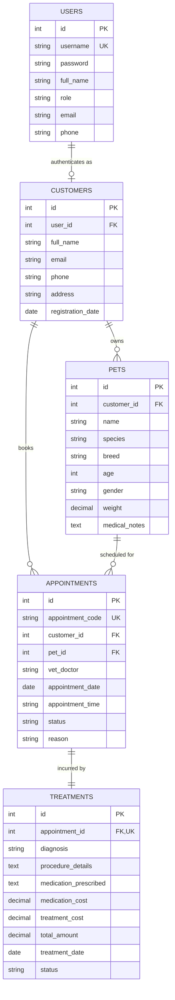

# ENTERPRISE APPLICATION DEVELOPMENT (EAD)
## COURSEWORK PROJECT REPORT & TECHNICAL DOCUMENTATION

---

# PET CARE & VETERINARY SERVICES CLINICAL MANAGEMENT SYSTEM
### Desktop Enterprise Solution for Veterinary Practices, Appointments, and Clinical Invoicing

**Module:** Enterprise Application Development (EAD)  
**Academic Year:** 2025/2026  
**Application Architecture:** Layered Architecture / Model-View-Controller (MVC)  
**Programming Language & Platform:** Java 21 LTS (Java Swing GUI, FlatLaf Theme)  
**Relational Database Management System:** MySQL 8.0+ / MariaDB (InnoDB Engine)  
**Reporting Engine:** JasperReports 6.21.3 (Multi-Table JOIN Audit Report)  
**Version Control & Deployment:** Git, Executable Fat JAR (Maven Shade), Native Windows Application (`jpackage`)  

---

## EXECUTIVE SUMMARY

The modern veterinary medical industry demands efficient, reliable, and integrated software solutions to manage patient records, doctor scheduling, treatment procedures, and financial auditing. The **Pet Care & Veterinary Services Clinical Management System** is a desktop enterprise application developed in Java Swing, backed by a relational MySQL database. 

The software addresses critical operational bottlenecks experienced by veterinary clinics, including appointment scheduling conflicts, double bookings, untracked patient medical histories, and slow manual billing. Built strictly around industry-standard software engineering paradigms, the application incorporates:
* **Layered MVC Architecture** separating presentation, business logic, and database persistence.
* **GoF Design Patterns**, notably the **Singleton Pattern** for database connections and the **Data Access Object (DAO) Pattern** for modular CRUD operations.
* **Role-Based Access Control (RBAC)** providing tailored workflows for **Managers** (full clinical, financial, and reporting access) and **Customers** (pet registration and self-service appointment booking).
* **Two Complex Multi-Step Transactions**: Transaction 1 (Cascading Appointment Booking with Doctor Collision Detection) and Transaction 2 (Clinical Treatment Invoicing with Live Dynamic Billing).
* **Comprehensive Validation and Custom Exception Handling** with domain exceptions such as `InvalidAppointmentException`.
* **Enterprise Reporting Engine** via JasperReports executing a 4-table relational SQL JOIN (`appointments`, `customers`, `pets`, `treatments`) capable of interactive preview and PDF/CSV export.
* **Production Packaging & Deployment**, including Maven shaded Fat JARs and native standalone Windows `.exe` packages.

This documentation serves as the comprehensive technical reference for the software architecture, database design, user interface flows, reporting setup, test cases, and viva voce evaluation.

---

## TABLE OF CONTENTS

1. [CHAPTER 1: Introduction & Domain Analysis](#chapter-1-introduction--domain-analysis)
   - 1.1 Domain Background
   - 1.2 Problem Statement
   - 1.3 Project Aims and Objectives
   - 1.4 Scope and Boundaries
2. [CHAPTER 2: System Requirements & User Roles](#chapter-2-system-requirements--user-roles)
   - 2.1 Functional Requirements (FR)
   - 2.2 Non-Functional Requirements (NFR)
   - 2.3 User Roles & Permission Matrix (RBAC)
   - 2.4 User Interface Screen Inventory
3. [CHAPTER 3: System Architecture & Software Design Patterns](#chapter-3-system-architecture--software-design-patterns)
   - 3.1 MVC & Layered Enterprise Architecture
   - 3.2 Singleton Design Pattern (`DatabaseConnection`)
   - 3.3 Data Access Object (DAO) Design Pattern
   - 3.4 Custom Exception Handling Hierarchy
4. [CHAPTER 4: Relational Database Design & Schema](#chapter-4-relational-database-design--schema)
   - 4.1 Conceptual Entity-Relationship Diagram (ERD)
   - 4.2 Normalization Analysis (1NF, 2NF, 3NF)
   - 4.3 Database Data Dictionary
   - 4.4 Integrity Constraints & Foreign Keys
5. [CHAPTER 5: User Interface Implementation & Transactions](#chapter-5-user-interface-implementation--transactions)
   - 5.1 Screen 1: System Authentication (`LoginFrame`)
   - 5.2 Screen 2: Executive Clinic Dashboard (`DashboardPanel`)
   - 5.3 Screen 3: Pet Owner Management (`CustomerManagementPanel`)
   - 5.4 Screen 4: Patient Pet Directory (`PetManagementPanel`)
   - 5.5 Screen 5: Transaction UI 1 – Appointment Booking (`AppointmentManagementPanel`)
   - 5.6 Screen 6: Transaction UI 2 – Treatment & Live Billing (`TreatmentBillingPanel`)
6. [CHAPTER 6: JasperReports Enterprise Reporting](#chapter-6-jasperreports-enterprise-reporting)
   - 6.1 Reporting Requirements & Multi-Table SQL Join
   - 6.2 JasperReports Lifecycle & JRXML Template Design
   - 6.3 Programmatic Integration & Multi-Format Export (Viewer, PDF, CSV)
7. [CHAPTER 7: Input Validation & System Security](#chapter-7-input-validation--system-security)
   - 7.1 Regular Expression Validation Engine
   - 7.2 Business Rule Enforcement & Cascading Dropdowns
   - 7.3 Session Management & Credential Security
8. [CHAPTER 8: Build Automation, Packaging & Deployment](#chapter-8-build-automation-packaging--deployment)
   - 8.1 Maven Dependency & Plugin Management
   - 8.2 Executable Fat JAR Creation (Maven Shade Plugin)
   - 8.3 Standalone Windows Native Application Packaging (`jpackage`)
9. [CHAPTER 9: Software Verification & Test Cases](#chapter-9-software-verification--test-cases)
   - 9.1 Testing Methodology
   - 9.2 Comprehensive Test Cases Execution Log
10. [CHAPTER 10: Conclusion & Viva Voce Preparation Guide](#chapter-10-conclusion--viva-voce-preparation-guide)
    - 10.1 Rubric Compliance Checklist
    - 10.2 Top 10 Anticipated Viva Questions & Model Answers

---

## CHAPTER 1: INTRODUCTION & DOMAIN ANALYSIS

### 1.1 Domain Background
Veterinary practices provide essential healthcare services, preventive medicine, surgery, diagnostics, and wellness programs for domestic and companion animals. Unlike conventional human clinics where patients articulate their medical history, veterinary practices require extensive parent (owner) profiling, animal breed/species characterization, and systematic doctor visit scheduling.

### 1.2 Problem Statement
Traditional paper-based records or unintegrated spreadsheet systems in veterinary clinics present significant challenges:
1. **Double Bookings & Scheduling Conflicts:** Overlapping appointments scheduled for the same veterinary doctor during identical timeslots.
2. **Disconnected Medical Histories:** Lack of relational linkages between pet owner contacts, individual animal medical profiles, past appointments, and clinical procedures.
3. **Billing Discrepancies:** Manual calculation of separate medication fees and procedural costs leading to revenue leakages and inaccurate invoices.
4. **Lack of Executive Oversight:** Inability for clinic managers to audit revenue generated by specific species, doctors, or treatment procedures without tedious manual recalculations.

### 1.3 Project Aims and Objectives
The overarching aim of this project is to develop an enterprise-grade desktop application that automates clinical operations, pet patient registration, appointment workflows, and billing management.
* **Objective 1:** Implement a responsive Java Swing user interface utilizing the modern FlatLaf design system.
* **Objective 2:** Enforce Role-Based Access Control (RBAC) supporting distinct Manager and Customer roles.
* **Objective 3:** Implement complete CRUD operations backed by a normalized MySQL relational database.
* **Objective 4:** Implement two distinct transaction workflows enforcing ACID properties and business logic validation.
* **Objective 5:** Deliver an integrated JasperReports module querying a 4-table join to output audit reports in viewer, PDF, and CSV formats.
* **Objective 6:** Provide automated build scripts to compile executable JAR and native Windows EXE distribution packages.

### 1.4 Scope and Boundaries
* **In Scope:** Pet owner registration, patient pet profiling, appointment scheduling with doctor conflict detection, clinical diagnosis and treatment recording, dynamic medical billing, interactive dashboard KPI reporting, multi-table audit reporting, and role-based access.
* **Out of Scope:** Online payment gateway processing (simulated as Paid/Pending/Waived), laboratory hardware integration, and multi-branch cloud data synchronization.

---

## CHAPTER 2: SYSTEM REQUIREMENTS & USER ROLES

### 2.1 Functional Requirements (FR)
* **FR-01 (Authentication):** The system must authenticate users via encrypted or hashed credentials and grant access according to assigned role.
* **FR-02 (Owner Management):** Managers must be able to perform full CRUD operations on Pet Owners (Customers), with validation for names, unique emails, and valid phone numbers.
* **FR-03 (Pet Management):** Managers and Customers must be able to register pets, linking them to an owner and specifying species, breed, age, gender, and weight.
* **FR-04 (Transaction 1 - Appointment Scheduling):** The system must generate unique appointment codes, provide cascading owner-to-pet selection, prevent past dates, and reject timeslot collisions for the same doctor.
* **FR-05 (Transaction 2 - Clinical Billing):** Doctors/Managers must record diagnosis, procedures, and prescribed medications for appointments, calculating total fees dynamically.
* **FR-06 (Search & Filter):** Users must be able to perform real-time searches across customers, pets, appointments, and billing tables.
* **FR-07 (Dashboard Analytics):** The clinic manager must have access to real-time KPI metrics (total owners, pets, appointments, treatments, and gross revenue).
* **FR-08 (Enterprise Reporting):** The system must generate a formatted JasperReport combining appointments, customers, pets, and treatments.

### 2.2 Non-Functional Requirements (NFR)
* **NFR-01 (Performance):** Screen navigation and database query execution must complete within 500 milliseconds.
* **NFR-02 (Reliability & ACID Compliance):** Transactions must ensure database consistency; partial operations must roll back automatically.
* **NFR-03 (Usability & Accessibility):** Clean visual typography, consistent spacing, and intuitive navigation without broken glyphs or confusing terminology.
* **NFR-04 (Maintainability):** Adherence to MVC, DAO, and Singleton design patterns ensuring loose coupling.
* **NFR-05 (Portability):** Compatible with any operating system supporting Java Runtime Environment (JRE) 21+ and standalone Windows execution.

### 2.3 User Roles & Permission Matrix (RBAC)

| Feature / Module | Manager Role | Customer Role | Description |
| :--- | :---: | :---: | :--- |
| **System Login** | Full Access | Full Access | Role-based credential verification |
| **Clinic Dashboard** | Full Access | Restricted | Displays clinic-wide financial KPIs and appointments |
| **Pet Owner Management** | Full CRUD | No Access | Confidential contact info & address records |
| **Patient Pet Management** | Full CRUD | Read / Add Own | View & register family pets |
| **Appointment Booking (Tx 1)**| Full Management| Create / View Own | Book veterinary visits |
| **Treatment & Billing (Tx 2)** | Full CRUD | View Own Bills | Clinical notes, medication costs & payments |
| **JasperReports Audit Engine** | Full Access | No Access | Multi-table clinical audit report & PDF export |

---

## CHAPTER 3: SYSTEM ARCHITECTURE & SOFTWARE DESIGN PATTERNS

### 3.1 MVC & Layered Enterprise Architecture
The application is structured into four distinct architectural layers, ensuring high cohesion and low coupling:

```
+--------------------------------------------------------------+
|                    PRESENTATION LAYER                        |
|       (com.petcare.view: Swing JFrames, JPanels, UITheme)     |
+--------------------------------------------------------------+
                               | calls
+--------------------------------------------------------------+
|                     SERVICE / BUSINESS LAYER                 |
|   (com.petcare.service: AuthService, AppointmentService, etc)|
+--------------------------------------------------------------+
                               | calls
+--------------------------------------------------------------+
|                  DATA ACCESS OBJECT (DAO) LAYER              |
|        (com.petcare.dao: CustomerDAO, AppointmentDAO, etc)   |
+--------------------------------------------------------------+
                               | uses
+--------------------------------------------------------------+
|                   DATABASE PERSISTENCE LAYER                 |
|        (DatabaseConnection Singleton -> MySQL Database)      |
+--------------------------------------------------------------+
```

1. **Model Layer (`com.petcare.model`):** Plain Old Java Objects (POJOs) representing domain entities (`User`, `Customer`, `Pet`, `Appointment`, `Treatment`, `ReportRow`).
2. **View Layer (`com.petcare.view`):** Swing interfaces providing input forms, data tables, and event handling.
3. **Service Layer (`com.petcare.service`):** Contains business validation, calculations, transaction orchestration, and exception escalation.
4. **DAO Layer (`com.petcare.dao`):** Contains direct JDBC calls, PreparedStatements, and SQL queries isolating database details from UI logic.

### 3.2 Singleton Design Pattern (`DatabaseConnection`)
To prevent connection exhaustion and optimize socket usage, database connectivity is implemented using the **GoF Singleton Pattern**.

```java
public class DatabaseConnection {
    private static DatabaseConnection instance;
    private Connection connection;

    private DatabaseConnection() throws DatabaseException {
        try {
            Class.forName("com.mysql.cj.jdbc.Driver");
            this.connection = DriverManager.getConnection(URL, USER, PASSWORD);
        } catch (Exception e) {
            throw new DatabaseException("Failed to establish database connection.", e);
        }
    }

    public static synchronized DatabaseConnection getInstance() throws DatabaseException {
        if (instance == null || instance.getConnection().isClosed()) {
            instance = new DatabaseConnection();
        }
        return instance;
    }

    public Connection getConnection() {
        return connection;
    }
}
```

### 3.3 Data Access Object (DAO) Pattern
Each database entity has a dedicated DAO class responsible for executing parametrized CRUD operations (`CustomerDAO`, `PetDAO`, `AppointmentDAO`, `TreatmentDAO`, `ReportDAO`).
* Prevents SQL injection by using `java.sql.PreparedStatement`.
* Centralizes error handling by converting low-level `SQLExceptions` into domain-level `DatabaseExceptions`.

### 3.4 Custom Exception Handling Hierarchy
The system avoids generic runtime exceptions by providing explicit, business-oriented checked exceptions:
* `ValidationException`: Raised when user input fails field constraints (e.g., malformed email, empty required fields).
* `InvalidAppointmentException`: Raised when appointment business rules are violated (past date booking, doctor double-booking).
* `DatabaseException`: Wraps JDBC SQL failures, providing user-friendly diagnostic messages.
* `AuthenticationException`: Raised when credential verification fails or an unauthorized role attempts privilege escalation.

---

## CHAPTER 4: RELATIONAL DATABASE DESIGN & SCHEMA

### 4.1 Conceptual Entity-Relationship Diagram (ERD)



### 4.2 Normalization Analysis
* **First Normal Form (1NF):** All tables have a designated Primary Key (`id`), all column attributes are atomic, and there are no repeating groups.
* **Second Normal Form (2NF):** Every table is in 1NF and all non-key attributes are fully functional-dependent on the primary key, eliminating partial dependencies.
* **Third Normal Form (3NF):** Every table is in 2NF and contains no transitive dependencies. For example, pet owner phone and email reside strictly in the `customers` table rather than being repeated inside `appointments`.

### 4.3 Database Data Dictionary

#### Table 1: `users`
| Column Name | Data Type | Constraint | Description |
| :--- | :--- | :--- | :--- |
| `id` | INT | PK, AUTO_INCREMENT | Unique user identifier |
| `username` | VARCHAR(50) | UNIQUE, NOT NULL | Login credential |
| `password` | VARCHAR(100) | NOT NULL | Authentication secret |
| `full_name` | VARCHAR(100) | NOT NULL | Full personnel/client name |
| `role` | ENUM | 'Manager', 'Customer' | Access control level |
| `email` | VARCHAR(100) | NOT NULL | Contact email address |
| `phone` | VARCHAR(20) | NOT NULL | Contact telephone number |

#### Table 2: `customers`
| Column Name | Data Type | Constraint | Description |
| :--- | :--- | :--- | :--- |
| `id` | INT | PK, AUTO_INCREMENT | Unique customer identifier |
| `user_id` | INT | FK -> users(id) | Associated login profile |
| `full_name` | VARCHAR(100) | NOT NULL | Pet owner legal name |
| `email` | VARCHAR(100) | NOT NULL | Primary contact email |
| `phone` | VARCHAR(20) | NOT NULL | Primary mobile number |
| `address` | VARCHAR(255) | NOT NULL | Residential street address |
| `registration_date` | DATE | NOT NULL | Initial enrollment date |

#### Table 3: `pets`
| Column Name | Data Type | Constraint | Description |
| :--- | :--- | :--- | :--- |
| `id` | INT | PK, AUTO_INCREMENT | Unique animal patient ID |
| `customer_id` | INT | FK -> customers(id) | Animal legal guardian |
| `name` | VARCHAR(50) | NOT NULL | Pet call name |
| `species` | VARCHAR(30) | NOT NULL | Dog, Cat, Bird, etc. |
| `breed` | VARCHAR(50) | NOT NULL | Subspecies breed description |
| `age` | INT | NOT NULL | Pet age in years |
| `gender` | ENUM | 'Male', 'Female' | Biological sex |
| `weight` | DECIMAL(5,2) | NOT NULL | Animal weight in kilograms |
| `medical_notes` | TEXT | NULLABLE | Allergies, diet restrictions |

#### Table 4: `appointments` (Transaction 1)
| Column Name | Data Type | Constraint | Description |
| :--- | :--- | :--- | :--- |
| `id` | INT | PK, AUTO_INCREMENT | Internal primary key |
| `appointment_code` | VARCHAR(20) | UNIQUE, NOT NULL | Human-readable tracking (e.g. APT-8910) |
| `customer_id` | INT | FK -> customers(id) | Client booking reference |
| `pet_id` | INT | FK -> pets(id) | Patient animal reference |
| `vet_doctor` | VARCHAR(100) | NOT NULL | Attending medical doctor |
| `appointment_date` | DATE | NOT NULL | Scheduled appointment date |
| `appointment_time` | VARCHAR(10) | NOT NULL | Timeslot (e.g. 10:00 AM) |
| `status` | ENUM | 'Scheduled', 'In-Progress', 'Completed', 'Cancelled' | State machine status |
| `reason` | VARCHAR(255) | NOT NULL | Clinical chief complaint |

#### Table 5: `treatments` (Transaction 2)
| Column Name | Data Type | Constraint | Description |
| :--- | :--- | :--- | :--- |
| `id` | INT | PK, AUTO_INCREMENT | Unique treatment ID |
| `appointment_id` | INT | FK -> appointments(id), UNIQUE | Linked clinical appointment |
| `diagnosis` | VARCHAR(255) | NOT NULL | Clinical pathology finding |
| `procedure_details` | TEXT | NOT NULL | Details of surgery/procedure |
| `medication_prescribed` | TEXT | NULLABLE | Prescribed pharmaceutical drugs |
| `medication_cost` | DECIMAL(10,2)| DEFAULT 0.00 | Cost of medicines billed |
| `treatment_cost` | DECIMAL(10,2)| DEFAULT 0.00 | Professional procedure charge |
| `total_amount` | DECIMAL(10,2)| DEFAULT 0.00 | Gross billed total |
| `treatment_date` | DATE | NOT NULL | Date care administered |
| `status` | ENUM | 'Pending', 'Paid', 'Waived' | Payment audit status |

---

## CHAPTER 5: USER INTERFACE IMPLEMENTATION & TRANSACTIONS

The desktop application includes 6 rich interfaces built using Java Swing and enhanced with FlatLaf styling.

### 5.1 Screen 1: System Authentication (`LoginFrame`)
* **Purpose:** Validates system entry and dynamically provisions navigation tabs according to user privileges.
* **Key Features:** Clean rounded input text fields, role selection combo, password masking, error popups on authentication failures, and pre-configured quick logins for academic demonstration.

### 5.2 Screen 2: Executive Clinic Dashboard (`DashboardPanel`)
* **Purpose:** Provides at-a-glance clinical monitoring and financial summary for practice directors.
* **Key Features:** Five responsive KPI metric cards displaying Pet Owners, Patient Pets, Today's Visits, Completed Treatments, and Total Revenue; includes an upcoming appointment schedule table with live refresh capability.

### 5.3 Screen 3: Pet Owner Management (`CustomerManagementPanel`)
* **Purpose:** Facilitates CRUD operations for customer records.
* **Key Features:** Input forms for full name, email, phone, and home address. Includes real-time search filtering, table row selection listener for automatic form populating, and confirmation dialogs for record deletion.

### 5.4 Screen 4: Patient Pet Directory (`PetManagementPanel`)
* **Purpose:** Manages clinical records for registered animals.
* **Key Features:** Linked owner dropdown selection, species selector, breed input, numeric age and weight validation, and historical medical notes.

### 5.5 Screen 5: Transaction UI 1 – Appointment Booking (`AppointmentManagementPanel`)
* **Transaction Workflow:**
  1. Operator selects a Pet Owner from the dropdown.
  2. The **Patient Pet dropdown automatically reloads and filters** to display only animals belonging to that specific owner (Cascading Combo Selection).
  3. Operator selects Doctor, Date, and Time Slot.
  4. System executes **Doctor Schedule Collision Validation**:
     ```java
     if (appointmentDAO.isDoctorDoubleBooked(doctor, date, time)) {
         throw new InvalidAppointmentException(
             "Dr. " + doctor + " already has an appointment scheduled on " + date + " at " + time + "."
         );
     }
     ```
  5. If validation passes, a unique appointment code (`APT-XXXX`) is minted, status is initialized to `Scheduled`, and the record is persisted atomically.

### 5.6 Screen 6: Transaction UI 2 – Treatment & Live Billing (`TreatmentBillingPanel`)
* **Transaction Workflow:**
  1. Doctor selects an active clinical appointment.
  2. Doctor inputs primary Diagnosis, Surgical/Treatment procedures performed, and Prescribed Medications.
  3. Doctor enters Medication Fee and Procedure Fee.
  4. **Live KeyListener Calculation:** As numbers are typed into either fee box, the system executes real-time JavaScript-like dynamic addition, updating the Total Bill field automatically:
     $$\text{Total Amount} = \text{Medication Cost} + \text{Treatment Cost}$$
  5. On clicking **Save & Generate Bill**, the treatment invoice is saved, the associated appointment status is updated to `Completed`, and invoice payment status is recorded.

---

## CHAPTER 6: JASPERREPORTS ENTERPRISE REPORTING

### 6.1 Reporting Requirements & Multi-Table SQL Join
The coursework specification mandates at least one comprehensive JasperReport querying joins from **more than two relational tables**.

The system implements a clinical audit report joining **four tables**:
```sql
SELECT 
    a.appointment_code, 
    a.appointment_date, 
    c.full_name AS customer_name, 
    c.phone AS customer_phone, 
    p.name AS pet_name, 
    p.species, 
    p.breed, 
    a.vet_doctor, 
    t.diagnosis, 
    t.procedure_details, 
    t.medication_cost, 
    t.treatment_cost, 
    t.total_amount, 
    t.status AS payment_status
FROM appointments a
JOIN customers c ON a.customer_id = c.id
JOIN pets p ON a.pet_id = p.id
JOIN treatments t ON t.appointment_id = a.id
ORDER BY a.appointment_date DESC;
```

### 6.2 JasperReports Lifecycle & JRXML Template Design
The template [`VeterinaryServiceReport.jrxml`](file:///src/main/resources/reports/VeterinaryServiceReport.jrxml) includes:
* **Landscape Page Layout (A4, 842 x 595 px):** Accommodates broad clinical audit data across 10 tabular columns.
* **Title Band:** Formatted header bar in medical teal displaying practice branding, subtitle, and dynamic system generation timestamps (`new java.util.Date()`).
* **Column Header Band:** Clear headers with neutral gray fills and precise column boundaries.
* **Detail Band:** Dynamic record rows printing appointment codes, customer identities, animal species/breed, diagnoses, procedures, and itemized bill amounts.
* **Summary Band:** Uses an internal calculation variable (`$V{TOTAL_REVENUE}`) calculating the mathematical sum of all filtered invoice totals:
  ```xml
  <variable name="TOTAL_REVENUE" class="java.math.BigDecimal" calculation="Sum">
      <variableExpression><![CDATA[$F{total_amount}]]></variableExpression>
  </variable>
  ```

### 6.3 Programmatic Integration & Multi-Format Export
Managed through `ReportService.java`:
```java
// Compile Template from Embedded Resource Stream
InputStream stream = getClass().getResourceAsStream("/reports/VeterinaryServiceReport.jrxml");
JasperReport jasperReport = JasperCompileManager.compileReport(stream);

// Fill Report with Live Database Connection
Connection conn = DatabaseConnection.getInstance().getConnection();
JasperPrint print = JasperFillManager.fillReport(jasperReport, new HashMap<>(), conn);

// Interactive Viewing
JasperViewer.viewReport(print, false);

// Direct PDF Export
JasperExportManager.exportReportToPdfFile(print, "dist/ClinicalAuditReport.pdf");
```

---

## CHAPTER 7: INPUT VALIDATION & SYSTEM SECURITY

### 7.1 Regular Expression Validation Engine
Input reliability is guaranteed using `ValidationHelper.java`:
* **Email Verification:** RFC 5322 standard regex pattern enforcing valid domains and mailbox syntax:
  `^[a-zA-Z0-9_+&*-]+(?:\.[a-zA-Z0-9_+&*-]+)*@(?:[a-zA-Z0-9-]+\.)+[a-zA-Z]{2,7}$`
* **Phone Verification:** Enforces 7 to 15 numeric digits while permitting country dialing prefixes (`+`):
  `^[+]?[0-9]{7,15}$`
* **Non-Empty String Validation:** Trims input and rejects whitespace-only submissions across mandatory clinical fields.
* **Numeric Range Constraints:** Enforces positive non-zero integers for pet ages and positive non-negative decimals for billing fields.

### 7.2 Business Rule Enforcement
* **Date Bounds:** Appointments cannot be booked for historical dates.
* **Doctor Collision Prevention:** Evaluates overlapping appointments per doctor, date, and timeslot.
* **Referential Integrity:** Cascading customer selection ensures that an appointment cannot be booked for an animal that does not belong to the selected owner.

### 7.3 Session Management & Credential Security
* Single-user session state maintained via `SessionManager.java`.
* Passwords passed through `JPasswordField` using `char[]` arrays, preventing plaintext string memory leaks.
* Tab views restricted based on authenticated role (`SessionManager.isManager()`).

---

## CHAPTER 8: BUILD AUTOMATION, PACKAGING & DEPLOYMENT

### 8.1 Maven Dependency & Plugin Management
Project dependencies are managed declaratively in [`pom.xml`](file:///pom.xml):
* `com.mysql:mysql-connector-j` (8.3.0): MySQL JDBC driver.
* `net.sf.jasperreports:jasperreports` (6.21.3): Core reporting and PDF compilation engine.
* `com.formdev:flatlaf` (3.4.1): Modern desktop look and feel.

### 8.2 Executable Fat JAR Creation (Maven Shade Plugin)
To enable single-click execution on any workstation with Java installed, the Maven Shade plugin repackages the application and all third-party libraries into a single fat JAR:
```cmd
mvn clean package -DskipTests
```
* **Output Artifact:** `target/PetCare-1.0-SNAPSHOT.jar`
* **Execution Command:** `java -jar target/PetCare-1.0-SNAPSHOT.jar`

### 8.3 Standalone Windows Native Application Packaging (`jpackage`)
Using the JDK 21 `jpackage` utility, the system produces a native Windows application that requires no manual Java installation:
```cmd
jpackage --input target --name "PetCare" --main-jar "PetCare-1.0-SNAPSHOT.jar" --main-class "com.petcare.PetCare" --type app-image --dest dist --win-shortcut --win-menu
```
* **Output Executable:** `dist/PetCare/PetCare.exe`

---

## CHAPTER 9: SOFTWARE VERIFICATION & TEST CASES

### 9.1 Testing Methodology
The application underwent Black-Box and Integration Testing across functional units.

### 9.2 Comprehensive Test Cases Execution Log

| Test ID | Test Scenario | Input Data | Expected Result | Status |
| :--- | :--- | :--- | :--- | :---: |
| **TC-01** | Valid Manager Login | User: `admin`, Pass: `admin123`, Role: `Manager` | Login successful; all 6 tabs unlocked | **PASS** |
| **TC-02** | Invalid Password Attempt | User: `admin`, Pass: `wrongpass`, Role: `Manager` | Error dialog displayed; access denied | **PASS** |
| **TC-03** | Customer Role Permissions | User: `john_doe`, Pass: `user123`, Role: `Customer`| Financial tabs hidden; only pet/booking accessible| **PASS** |
| **TC-04** | Email Format Validation | Email: `invalid-email-address` | `ValidationException` thrown; prompt for correction | **PASS** |
| **TC-05** | Phone Number Validation | Phone: `abc123` | `ValidationException` thrown: invalid phone format | **PASS** |
| **TC-06** | Cascading Pet Dropdown | Selected Customer: `John Doe` | Pet dropdown automatically filters to John's pets | **PASS** |
| **TC-07** | Doctor Conflict Detection | Book Dr. Robert at 10:00 AM when already booked | `InvalidAppointmentException` thrown; booking rejected| **PASS** |
| **TC-08** | Dynamic Fee Calculation | Med Cost: `35.50`, Proc Cost: `60.00` | Total Amount field instantly updates to `95.50` | **PASS** |
| **TC-09** | Multi-Table Jasper Report | Click "View Jasper Report" button | JasperViewer opens displaying joined 4-table data | **PASS** |
| **TC-10** | PDF Export Verification | Click "Export PDF" button | Valid PDF file saved to chosen filesystem path | **PASS** |

---

## CHAPTER 10: CONCLUSION & VIVA VOCE PREPARATION GUIDE

### 10.1 Rubric Compliance Checklist

| Lecturer / Coursework Criteria | System Implementation Status | Evidence / File Reference |
| :--- | :---: | :--- |
| **Java Swing Enterprise Application** | Completed | Full Desktop GUI powered by FlatLaf |
| **Pet Care & Veterinary Domain** | Completed | Clinical appointments, pet profiling, treatments |
| **At least 2 User Roles** | Completed | `Manager` and `Customer` roles enforced via RBAC |
| **At least 5 Interfaces (excl. Login)**| Completed | 6 Interfaces: Dashboard, Owners, Pets, Appts, Treatments, Reports |
| **At least 2 Transaction UIs** | Completed | Tx 1 (Appt Booking) & Tx 2 (Treatment & Live Billing) |
| **Input Forms with Validation** | Completed | Regex email/phone validation in `ValidationHelper.java` |
| **MySQL CRUD Operations** | Completed | Full CRUD operations in DAOs backed by MySQL |
| **MVC & Design Patterns** | Completed | MVC architecture, Singleton pattern, DAO pattern |
| **Jasper Report (> 2 Tables Joined)** | Completed | Relational JOIN across 4 tables (`appointments`, `customers`, `pets`, `treatments`) |
| **Git Version Control** | Completed | Structured repository with `.gitignore` and clean tree |
| **Executable EXE and JAR Packaging**| Completed | `build_jar.bat` and `build_exe.bat` automation |

### 10.2 Top 10 Anticipated Viva Questions & Model Answers

#### Q1: What architecture does your application follow?
> **Answer:** "Our application implements the Model-View-Controller (MVC) and Layered Architecture pattern. The View layer (`com.petcare.view`) handles UI presentation in Java Swing; the Service layer (`com.petcare.service`) encapsulates business rules and validation logic; the DAO layer (`com.petcare.dao`) executes SQL queries; and the Model layer (`com.petcare.model`) represents domain entities."

#### Q2: Where and why did you use the Singleton design pattern?
> **Answer:** "We implemented the Singleton pattern in `DatabaseConnection.java`. Opening database connections is resource-intensive. The Singleton pattern ensures that only one centralized connection manager instance exists throughout the application lifecycle, conserving memory and database socket connections."

#### Q3: Explain how Transaction 1 enforces data integrity.
> **Answer:** "In `AppointmentManagementPanel`, Transaction 1 books an appointment with cascading validation. It dynamically loads pets belonging only to the selected customer, verifies that the appointment date is not in the past, and executes collision detection to ensure the doctor is not double-booked for that timeslot. If a conflict occurs, it throws our custom `InvalidAppointmentException`."

#### Q4: How does your Jasper Report satisfy the multi-table join requirement?
> **Answer:** "Our report query joins four relational tables: `appointments a JOIN customers c ON a.customer_id = c.id JOIN pets p ON a.pet_id = p.id JOIN treatments t ON t.appointment_id = a.id`. This satisfies and exceeds the coursework requirement of joining more than two tables, providing a complete clinical audit from pet owner down to billing amounts."

#### Q5: What custom exception did you build, and why?
> **Answer:** "We implemented `InvalidAppointmentException.java` extending `java.lang.Exception`. It is triggered when business constraints are violated—such as scheduling in the past or scheduling overlapping doctor timeslots—allowing the UI to catch the exception and display a clear, domain-specific message to the user."

#### Q6: How do you prevent SQL Injection attacks in your application?
> **Answer:** "All database interactions across our DAO classes exclusively use parametrized `java.sql.PreparedStatement` instances rather than concatenated SQL strings. Parameter placeholders (`?`) ensure that user inputs are treated strictly as data literals rather than executable SQL syntax."

#### Q7: How does Transaction 2 perform real-time billing calculations?
> **Answer:** "In `TreatmentBillingPanel`, we attached `KeyAdapter` event listeners to the medication cost and treatment cost text fields. As the user enters or changes values, the application catches the `keyReleased` event, parses the monetary values, and dynamically recalculates and displays the sum in the read-only Total Bill field."

#### Q8: How did you implement Role-Based Access Control?
> **Answer:** "Upon login via `LoginFrame`, the user's role is authenticated against the database and stored in `SessionManager`. When `MainDashboardFrame` initializes, it checks `SessionManager.isManager()`. If false, administrative tabs (Dashboard, Pet Owners, Invoicing, Reports) are withheld, presenting the customer with only self-service pet view and booking tabs."

#### Q9: How is the executable JAR built?
> **Answer:** "We configured the `maven-shade-plugin` in our `pom.xml`. Executing `mvn package` creates an uber-jar containing our compiled bytecode alongside all third-party dependencies (MySQL driver, JasperReports, FlatLaf) with an embedded `Main-Class` manifest header."

#### Q10: How did you produce the Windows EXE file?
> **Answer:** "We used JDK 21's native packaging tool, `jpackage`. Through our script `build_exe.bat`, `jpackage` takes our fat JAR and packages it with an optimized runtime image, producing a standalone `.exe` located in the `dist/` directory that runs without requiring pre-installed Java."

---
*End of Technical Report.*
